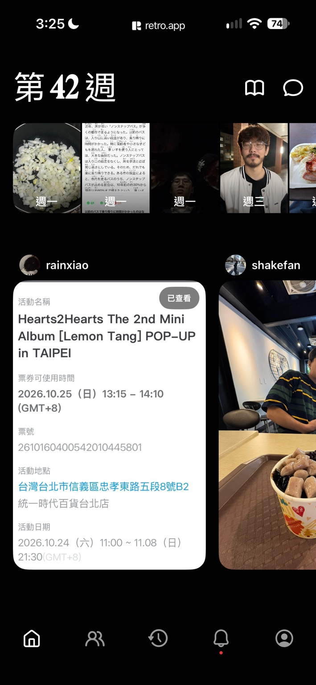
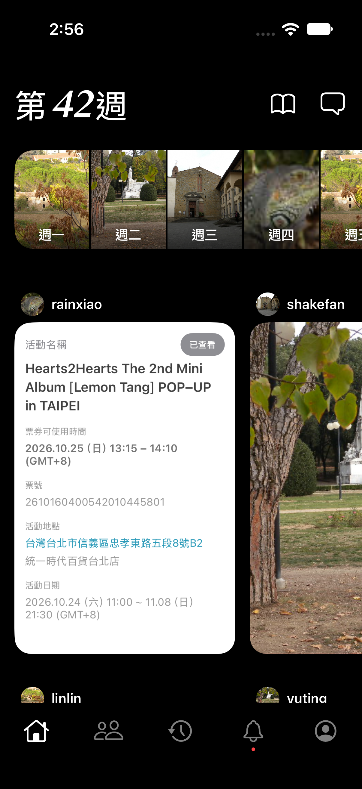

# Retro SwiftUI 課堂作業

在原有 Retro.xcodeproj 與 MyApp target 中完成的一頁靜態 Retro 首頁。使用固定本地資料，沒有登入、API 或其他服務；底部圖示僅展示外觀。

## 開啟與驗證

在 Xcode 開啟 Retro.xcodeproj，選擇 Retro scheme 與 iPhone 模擬器後 Run。

1. 在主內容向上滑，確認看到第二列 linlin、yuting 等好友。
2. 在每日照片左右滑，確認能看到週六、週日。
3. 在好友卡片左右滑，確認能看到下一位好友。
4. 上下滑動時，底部五個圖示應固定；最後一列應能完整滑到導覽列上方。
5. 檢查標題、票券文字、圖片與系統狀態列沒有重疊或異常裁切。

黑底白字是刻意比照參考圖，未額外實作淺色主題。時間、電量、Home indicator 由系統呈現。原始參考圖保存在 reference/retro-home.jpg，不會打包進 App。

## 必做要求對照

| 要求 | 實作位置 |
| --- | --- |
| VStack | ContentView 主內容、FriendCardView 名字與卡片 |
| HStack | WeekHeaderView、每週照片列、好友列、BottomBarView |
| ZStack | DayPhotoView 疊放照片、漸層、星期文字 |
| Text | 週數、星期、好友姓名、TicketView 票券 |
| Image | 每日照片與頭像使用 Assets；標題與底列使用 SF Symbols |
| ScrollView | ContentView 垂直捲動；照片與好友列水平捲動 |
| Assets 圖片 | 四個 imageset 都包含實際 JPEG 與 Contents.json |
| 多個 modifier | padding、font、background、foregroundStyle、frame、clipShape 等 |
| 上下捲動內容 | 七天照片與兩列共六張好友卡片，超過一般 iPhone 可視高度 |
| 多個 Swift 檔案 | 八個畫面／資料檔與原有 App 入口 |
| property 接收資料 | week、photos、imageName、day、post、cardWidth、title、selectedSymbol |

## 元件與 property 的用途

- ContentView：組合垂直主內容；GeometryReader 取得寬度，卡片占 61%，露出下一張。safeAreaInset 固定底部列並保留其空間。
- WeekHeaderView(week:)：接收週數，排列標題、相簿與訊息圖示。
- WeekPhotoStripView(photos:)：接收 DayPhoto 陣列，以 ForEach 重用每日照片元件。
- DayPhotoView(imageName:day:)：接收 Assets 名稱與星期，在 ZStack 裡疊上漸層與文字。
- FriendCardView(post:cardWidth:)：post 提供姓名、頭像、照片與票券類型；cardWidth 控制大小。同一元件可顯示不同好友。
- TicketView(title:)：接收活動名稱，用真正 Text 與容器重建白色票券；其他欄位是固定示範文字。
- BottomBarView(selectedSymbol:)：接收目前頁面的圖示名稱，決定白色選取狀態；其他為灰色，通知下方有紅點。
- SampleData：集中七天照片與六位好友資料。DayPhoto、FriendPost 使用 Identifiable，讓 ForEach 能分辨每筆資料。

MyApp 是既有 PBXFileSystemSynchronizedRootGroup，目錄已綁定 Retro target，新增 Swift 與 Assets 會自動編入；未另建專案。

## 驗證紀錄與未驗證項目

- iOS Simulator SDK Debug build 已成功（arm64、x86_64），紀錄：artifacts/build.log。
- iOS Simulator SDK Swift 型別檢查已通過，紀錄：artifacts/typecheck.log。
- 既有 target 的 macOS Debug build 已成功，紀錄：artifacts/mac-build.log。
- 已檢查四個 imageset 的 JSON、圖片存在，App 產物包含 Assets.car。
- 截圖腳本已通過 bash -n 語法檢查。
- 自動執行環境無法連上 CoreSimulatorService；使用者已在 iPhone 17 模擬器取得成品截圖（2026-10-18），保存於 screenshots/retro-home.png。截圖確認首頁已顯示；上下與左右捲動仍需人工操作驗證。
- 預覽使用 Xcode 27 建議的具名 #Preview 巨集；此受限命令列環境無法啟動巨集外掛，請在 Xcode Canvas 檢查預覽。

## 原始畫面與成品對照

| 原始 Retro 參考畫面 | SwiftUI 成品（iPhone 17） |
| --- | --- |
|  |  |

成品截圖由使用者提供，未修改；替換本地照片，保留週數、卡片、票券與底部導覽的參考排版。

## 截圖及作業展示

先在一般 macOS 環境啟動 iPhone 模擬器，再執行：

```bash
cd <專案所在資料夾>
bash scripts/capture-simulator.sh
```

也可把 iPhone 的 UDID 作為第一個參數。腳本會建置、安裝並啟動 App；等你檢查畫面與捲動後，在終端機按 Enter，即儲存真實模擬器截圖至 artifacts/retro-home.png。不修改系統時間或電量。

展示時將 reference/retro-home.jpg 與 artifacts/retro-home.png 並排。也可用 Simulator 的 File → Save Screen。請先完成上方操作檢查，再作為正式成果。

## 圖片來源

替代素材取自 [ianare/exif-samples](https://github.com/ianare/exif-samples)。該 repository README 說明使用者貢獻圖片採 [CC BY-SA 4.0](https://creativecommons.org/licenses/by-sa/4.0/)。原圖未修改，顯示裁切由 SwiftUI scaledToFill 完成，原有 EXIF 資訊保留在 JPEG。

| Assets 名稱 | 原始路徑 |
| --- | --- |
| TravelLake | jpg/gps/DSCN0010.jpg |
| TravelGarden | jpg/gps/DSCN0021.jpg |
| TravelCity | jpg/gps/DSCN0040.jpg |
| AvatarCamera | jpg/Canon_40D.jpg |

原始參考畫面來自 Yogurtheyork/RetroReplica/reference/retro-home.jpg，僅作課堂比較，不作 App UI。

## 專案設定

直接使用已提交的 Retro.xcodeproj 與 Retro scheme。原有 project.yml 亦已將來源改為 MyApp，供需要 XcodeGen 的既有工作流程使用；原有 GitHub Actions 設定保留，未新增流程。
